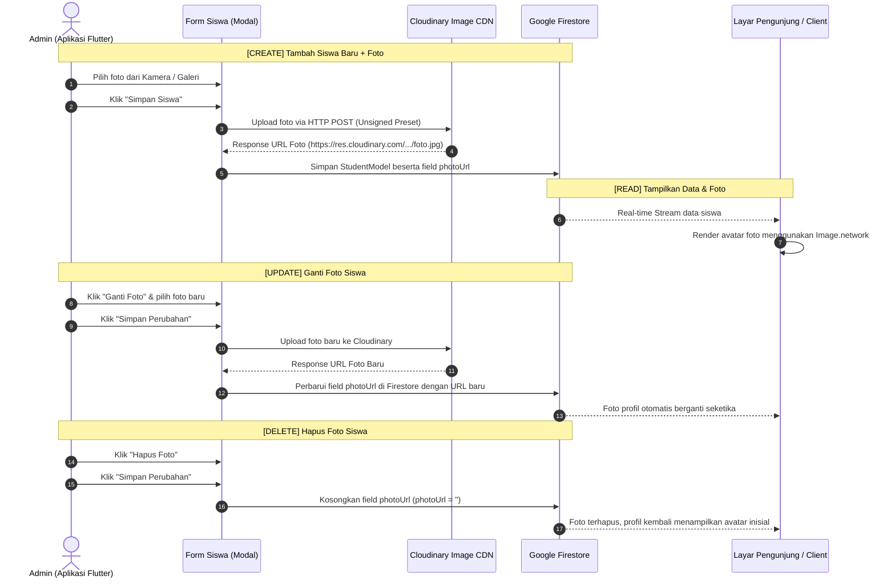

# 📸 Dokumen Perencanaan: Implementasi CRUD Foto Siswa (Cloudinary + Firestore)

Dokumen ini memuat panduan lengkap, arsitektur teknis, alasan bisnis/keamanan, serta alur pengerjaan fitur **Upload dan Manajemen Foto Siswa** pada aplikasi **SekolahKu (Data Management Siswa)**.

---

## 📌 1. Latar Belakang & Pemilihan Solusi

### 1.1 Masalah pada Firebase Storage
- Firebase Storage sering kali mewajibkan aktivasi paket **Blaze (Pay as you go)** yang meminta informasi kartu kredit/debit.
- Bagi siswa sekolah / peserta Ujikom, hal ini berisiko memicu tagihan tak terduga jika terjadi kesalahan konfigurasi atau kebocoran pemakaian.

### 1.2 Kenapa Memilih Cloudinary?
1. **100% GRATIS Tanpa Kartu Kredit:** Pendaftaran cukup menggunakan akun Google biasa.
2. **Kapasitas Besar:** Kuota gratis **25 GB per bulan** (cukup untuk menampung puluhan ribu pas foto siswa).
3. **Arsitektur Standar Industri (*Separation of Concerns*):**
   - **Database (Firestore):** Khusus menyimpan data tekstual & relasi (NIS, Nama, Kelas, URL foto).
   - **Asset CDN (Cloudinary):** Khusus menyimpan dan mengoptimalkan file fisik gambar.
4. **Fitur Otomatis:** Cloudinary memiliki kemampuan kompresi otomatis dan deteksi wajah (*auto face crop*) agar pas foto selalu presisi.

---

## 🔄 2. Arsitektur & Mekanisme Siklus CRUD Foto

Meskipun menggunakan penyimpanan cloud eksternal, seluruh siklus **CRUD (Create, Read, Update, Delete)** foto siswa tetap berfungsi 100% normal dan terintegrasi:



---

## 🔐 3. Mengapa Menggunakan Mode "Unsigned Upload Preset"?

Pertanyaan ini sering muncul dari penguji atau developer lain:

| Jenis Upload | Cara Kerja | Risiko / Kendala pada Mobile App |
| :--- | :--- | :--- |
| **Signed Upload** | Membutuhkan pembuatan tanda tangan kriptografi (*digital signature*) menggunakan `API Secret Key`. | **SANGAT BERBAHAYA di Flutter:** Aplikasi mobile dapat dibongkar (*reverse engineer*). Jika `API Secret Key` ditaruh di dalam kode Flutter, kunci tersebut bisa dicuri dan disalahgunakan untuk menghapus seluruh aset cloud. Mode ini hanya aman jika ada backend server khusus (Node.js/Laravel). |
| **Unsigned Upload (Pilihan Kita)** | Menggunakan preset publik yang hanya diberi izin **UNGGAH FILE SAJA**. Tidak memerlukan `API Secret Key`. | **SANGAT AMAN & TEPAT:** Aplikasi Flutter tidak menyimpan rahasia apa pun. Siapapun yang melihat kode APK **tidak bisa** menghapus file, tidak bisa melihat file privat, dan tidak bisa mengubah konfigurasi akun. |

> **Prinsip Keamanan:** Mengikuti standar *Least Privilege* (hanya memberikan izin minimum yang dibutuhkan oleh aplikasi klien).

---

## 📝 4. Panduan Registrasi Cloudinary (3 Menit)

Lakukan langkah mudah berikut sekali saja:

1. **Daftar Akun:**
   - Kunjungi [https://cloudinary.com](https://cloudinary.com).
   - Klik **Sign Up for Free**, lalu pilih **Sign in with Google**.
2. **Ambil Cloud Name:**
   - Di halaman Dashboard utama / Dashboard console, lihat kolom **Cloud name** (contoh: `dkn0xyz12`).
3. **Buat Upload Preset (Unsigned):**
   - Klik ikon **Settings (⚙️)** di pojok kiri bawah.
   - Pilih tab menu **Upload**.
   - Scroll ke bawah ke bagian **Upload presets**, klik **Add upload preset**.
   - Pada opsi **Signing Mode**, ganti dari *Signed* menjadi **Unsigned**.
   - Berikan nama preset (contoh: `sekolahku_siswa`).
   - *(Opsional)* Pada tab *Upload Manipulations*, kamu bisa mengatur *Incoming Transformation* (misal: format JPG, mode Fill, ukuran 300x300 px).
   - Klik tombol **Save**.
4. **Hasil yang Dibutuhkan:**
   - `cloud_name`
   - `upload_preset`

---

## 💻 5. Rencana Perubahan Kode di Flutter

### 5.1 Penambahan Dependensi di `pubspec.yaml`
```yaml
dependencies:
  flutter:
    sdk: flutter
  image_picker: ^1.1.2   # Memilih gambar dari Kamera / Galeri HP
  http: ^1.2.2           # Mengirim multipart request upload ke Cloudinary
```

### 5.2 Izin Perangkat Android (`android/app/src/main/AndroidManifest.xml`)
Menambahkan permission untuk kamera dan akses media:
```xml
<uses-permission android:name="android.permission.CAMERA" />
<uses-permission android:name="android.permission.READ_EXTERNAL_STORAGE" />
<uses-permission android:name="android.permission.READ_MEDIA_IMAGES" />
```

### 5.3 Pembaruan Model (`StudentModel`)
Menambahkan field `photoUrl`:
```dart
class StudentModel {
  final String photoUrl; // Link foto dari Cloudinary (default: '')
  // ... field lainnya
}
```
*Backward compatibility 100% terjaga:* Siswa yang belum memiliki foto akan otomatis bernilai `photoUrl = ''` dan tetap menampilkan inisial avatar.

### 5.4 Pembuatan `CloudinaryService` (`lib/core/services/cloudinary_service.dart`)
Layanan terisolasi untuk menangani pengiriman file gambar ke endpoint REST API Cloudinary:
- Endpoint: `https://api.cloudinary.com/v1_1/<cloud_name>/image/upload`
- Mengirimkan file dan parameter `upload_preset`.
- Mengembalikan string `secure_url`.

### 5.5 Pembaruan UI Form Siswa (`StudentFormModal`)
- Komponen Avatar Picker lingkaran (80x80 px) di bagian atas modal form.
- Tombol aksi:
  - 📷 **Ambil dari Kamera**
  - 🖼️ **Pilih dari Galeri**
  - 🗑️ **Hapus Foto** (jika sudah ada foto)
- Menampilkan status loading spinner saat foto sedang di-upload ke cloud.

### 5.6 Pembaruan Tampilan Kartu & Detail Siswa
- **`StudentCard`:** Jika ada `photoUrl`, tampilkan foto profil bundar/rounded. Jika tidak ada, tampilkan inisial huruf seperti biasa.
- **`StudentDetailModal`:** Menampilkan foto profil siswa dalam ukuran besar (80 px) di bagian header detail siswa.
- **`PrintDialogModal`:** Foto siswa dapat disertakan pada lembar cetak laporan data siswa.

---

## 🎓 6. Kisi-kisi Jawaban untuk Guru / Penguji Ujikom

Jika saat presentasi atau sidang tugas guru mengajukan pertanyaan, berikut contekan jawabannya:

**T: Kenapa tidak menggunakan Firebase Storage?**  
*J: "Firebase Storage pada proyek baru mewajibkan aktivasi paket Blaze (Pay as you go) yang meminta kartu kredit. Untuk menghindari risiko biaya dan tetap menggunakan layanan cloud kelas enterprise, kami memilih Cloudinary yang menyediakan tier gratis 25 GB/bulan tanpa memerlukan kartu kredit."*

**T: Kenapa upload preset-nya disetting Unsigned?**  
*J: "Karena arsitektur kami adalah client-to-cloud (serverless). Mode Unsigned memastikan aplikasi mobile Flutter tidak mengekspos API Secret Key di dalam kode APK, sehingga aplikasi aman dari upaya pencurian kunci kredensial jika APK dibongkar."*

**T: Bagaimana jika admin ingin menghapus atau mengganti foto siswa?**  
*J: "Siklus CRUD foto dikelola melalui relasi metadata di Firestore. Ketika foto dihapus, aplikasi mengosongkan field `photoUrl` di Firestore sehingga profil siswa langsung bersih. Ketika foto diganti, aplikasi mengupload foto baru dan memperbarui pointer `photoUrl` di database."*

---

*Dokumen ini siap digunakan sebagai acuan pengembangan dan laporan resmi proyek.*
